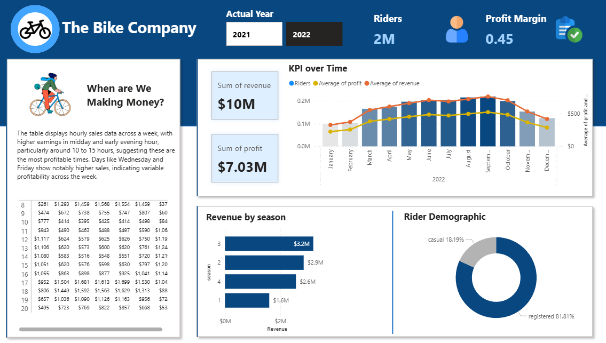

# Bike Share Revenue & Pricing Analysis

An end-to-end data analytics project using SQL Server and Power BI to analyse bike-sharing revenue, profitability, rider demographics, and seasonal trends for The Bike Company across 2025 and 2026.

## Project Overview

This project analyses the business performance of The Bike Company, a fictional bike-sharing business, using two years of bike-sharing data.

The objective is to understand revenue and profit trends, identify the most profitable periods, analyse rider demographics, and evaluate potential pricing adjustments for the following year.

SQL Server was used to consolidate the datasets and calculate key financial metrics, while Power BI was used to build an interactive dashboard for business analysis.

## Business Problem

The Bike Company required a dashboard to monitor its key performance indicators and support informed business decisions.

The analysis was expected to address the following requirements:

- Analyse hourly revenue and identify the most profitable times.
- Track revenue and profit trends over time.
- Compare revenue across different seasons.
- Understand rider demographics, including casual and registered users.
- Evaluate the possibility of increasing prices for the following year.

## Tools & Technologies

| Tool | Purpose |
|---|---|
| Microsoft SQL Server | Data consolidation, transformation, and querying |
| SQL | CTEs, UNION ALL, JOINs, and calculated financial metrics |
| Microsoft Power BI | Interactive dashboard and data visualisation |
| DAX | KPI calculations and dashboard metrics |
| CSV | Source data format |

## Dataset

The project uses three source tables:

- `bike_share_yr_0` – Bike-sharing records mapped to 2025.
- `bike_share_yr_1` – Bike-sharing records mapped to 2026.
- `cost_table` – Year-wise pricing and cost information.

**Year Mapping:** The original dataset uses year codes `yr_0` and `yr_1`. For this project, `yr_0` is treated as 2025 and `yr_1` as 2026. These labels are used consistently in the analysis and dashboard.

The two yearly bike-sharing tables were consolidated into a unified dataset for analysis.

## SQL Analysis & Data Preparation

SQL Server was used to prepare the main dataset from the source tables.

Key operations included:

1. **Data Consolidation:** Combined the two yearly bike-sharing tables using `UNION ALL` inside a Common Table Expression (CTE).
2. **Table Joining:** Used a `LEFT JOIN` to combine bike-sharing records with the cost table based on the year.
3. **Revenue Calculation:** Calculated revenue by multiplying the number of riders by the corresponding price.
4. **Profit Calculation:** Calculated profit by subtracting total costs from revenue.
5. **Data Preparation:** Selected relevant date, seasonal, weekday, hourly, rider-type, and financial fields for further analysis.

The resulting dataset was used in Power BI for visualisation and business analysis.

## Power BI Dashboard

The dashboard provides an overview of the company's performance through key metrics and interactive visualisations.

### Key Features

- **KPI Cards:** Total riders, revenue, profit, and profit margin.
- **Revenue & Profit Trends:** Monthly performance analysis over time.
- **Hourly Revenue Analysis:** Identifies the hours with the highest revenue and profitability.
- **Seasonal Revenue:** Compares revenue performance across seasons.
- **Rider Demographics:** Visualises the distribution of casual and registered riders.
- **Year Selection:** Allows users to compare performance across 2025 and 2026.

## Key Findings

The dashboard highlights several business insights:

- The business generated approximately $10 million in revenue and $7.03 million in profit, according to the displayed dashboard KPIs.
- Midday and early evening hours, particularly around 10:00–15:00, show strong revenue performance.
- Wednesday and Friday show comparatively higher sales during several hours.
- Seasonal revenue varies, with one season generating approximately $3.2 million.
- Registered riders account for approximately 81.81% of riders, while casual riders account for 18.19%.

## Business Recommendations & Pricing Strategy

Based on the pricing analysis, a conservative price increase of 10–15% was recommended to balance revenue growth with the risk of losing customers.

Using the $4.99 reference price:

| Price Increase | Proposed Price |
|---|---:|
| 10% | $5.49 |
| 15% | $5.74 |

Recommended actions:

- **Conservative Price Increase:** Test a 10–15% increase rather than making an aggressive adjustment.
- **Market Analysis:** Research customer satisfaction, competitors, and market conditions before finalising prices.
- **Segmented Pricing:** Consider different pricing strategies for casual and registered riders.
- **Monitor and Adjust:** Track customer feedback and sales performance after implementing the new prices.

## Project Files

| Folder / File | Description |
|---|---|
| `Data/` | Source bike-sharing and cost datasets |
| `SQL/` | SQL query used for data preparation and calculations |
| `PowerBI/` | Interactive Power BI dashboard |
| `Images/` | Dashboard screenshots and project visuals |

## How to View the Project

1. Browse the dashboard screenshots in the `Images/` folder.
2. Download the `.pbix` file from the `PowerBI/` folder and open it using Microsoft Power BI Desktop.
3. Review the SQL script in the `SQL/` folder to understand the data preparation process.
4. Explore the CSV datasets in the `Data/` folder.

**Requirements:** Microsoft Power BI Desktop and Microsoft SQL Server (for reproducing the SQL workflow).

## Author

**Harsh Kumar**

- **GitHub:** [hash1531](https://github.com/hash1531)
- **LinkedIn:** [LinkedIn Profile](https://www.linkedin.com/in/harsh-kumar-921246287/)
- **Email:** [harshdps02@gmail.com](mailto:harshdps02@gmail.com)

---

*This project demonstrates an end-to-end data analytics workflow, from SQL-based data preparation to interactive Power BI reporting and business-oriented pricing recommendations.*
